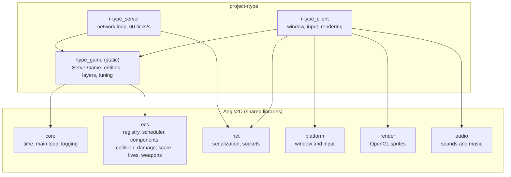
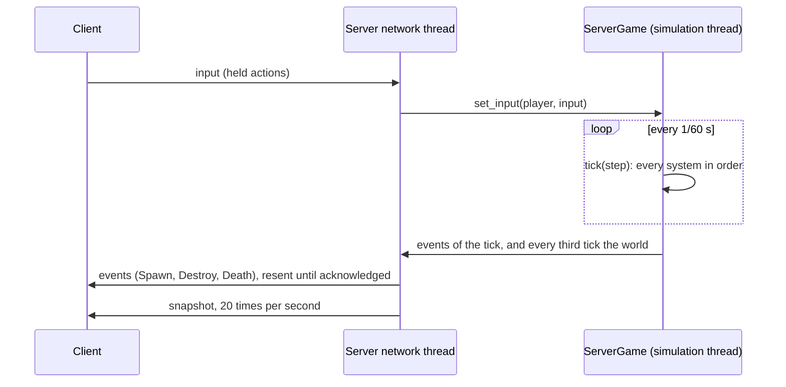

# Architecture

R-Type is a thin game on top of the Aegis2D engine. The engine provides generic
building blocks (an ECS, gameplay systems, networking, rendering, audio); the game
chooses the entities, the values and the order of the systems.

## Layers



| Layer | Where | Server | Client |
|---|---|---|---|
| Game logic | `rtype_game` (`game/`) on the engine's `ecs` | ✓ | to predict and display |
| Networking | engine `net`, wired in `server/` and `client/` | ✓ | ✓ |
| Rendering, input, sound | engine `platform`, `render`, `audio` | | ✓ |

The server never links the client modules: the `server` presets build without SDL3 or
OpenGL.

## Authoritative server

The server owns the only true world. Each client sends the actions its player holds
(one byte per tick: up, down, left, right, fire); the server applies them, runs the
simulation and sends back what happened. A client never decides a hit, a kill or a score.



The server's network side lives in `server/`, around
[`ServerGame`](gameplay.md#the-server-game), which exposes what it needs: `add_player()`,
`set_input()`, `tick()` and the reports of the last tick. `GameServer`
(`rtype/game_server.hpp`) puts the pieces together, for `r-type_server` and for the tests:
`ServerNetwork` on the network thread, the game on the `Simulation` thread, and tasks
posted between them. A bound player joins the game: the others get its `PlayerJoined`
(number and name), and it gets a `PlayerJoined` of every player already there before the
world. A player whose session ends leaves it, whatever ended it (`Logout`, `Disconnect`,
protocol error, its TCP connection closing, as when its process is killed, or no valid
datagram for 5 seconds, as when its UDP is blocked): the others get its `PlayerLeft`, with
the reason `Left`, `TimedOut` or `Kicked`, and its ship is removed at the next tick. After
each tick, the simulation thread hands the network thread two things:

- **Events** (`rtype/events.hpp`, RFC section 4.4): `EventTracker` compares the replicated
  entities with those of the previous tick. A new one is a `Spawn` (the shot of a missile
  is its `Spawn`, owned by the shooter's player), a vanished one a `Destroy` at its last
  position, whose reason comes from the tick's reports (killed, missile spent, off screen,
  player left), and each life lost a `Death`. Each player's `ReliableChannel` resends them
  until they are acknowledged. A player who joins first gets a `Spawn` of every entity
  already there.
- **Snapshots** (`rtype/snapshot.hpp`, RFC section 4.3), every third tick: the position,
  velocity and frame of every entity, and each player's lives and score. They are not
  resent: the next one replaces a lost one.

## The code

```
game/
  include/rtype/
    server_game.hpp   ServerGame: the world, its systems in tick order, the players
    entities.hpp      spawn_player, spawn_player_missile, spawn_bydos_slave...
    layers.hpp        collision layers and masks
    tuning.hpp        every gameplay value (speeds, sizes, health, lives, scores)
    waves.hpp         enemy types of the waves files, load_waves
  server_game.cpp
  entities.cpp
  waves.cpp
assets/waves/         enemy waves (JSON), copied next to r-type_server
server/main.cpp       r-type_server
client/main.cpp       r-type_client
tests/                Catch2 tests of rtype_game
```

- **The engine does the generic work.** Movement, collisions, damage, score, lives and
  weapons are engine functions (`aegis2d::ecs`, see the
  [engine API](https://aegis2d-docs.pages.dev/api/)). The game only composes them; a
  feature any shoot'em up would need goes to the engine first, then is wired here.
- **Data lives in components, values in `tuning.hpp`.** Entities are plain handles; what
  they are comes from their components, and every number comes from `rtype::tuning`.
- **`rtype_game` is a static library.** The engine's registry finds component pools by
  `typeid`. With libc++ (macOS), a type's `typeid` differs between shared libraries, so
  code that reads components must be compiled into the binaries, never behind another
  shared library.
- **Systems are functions.** Each step of the tick is a function registered in the
  engine's `Scheduler` under a name, so the order is written in one place
  (`ServerGame::register_systems()`) and can be listed, disabled or tested on its own.

## Delivery

Development happens in two repositories, the engine and the game. For the Epitech
delivery, a push to `master` here asks the engine repository to assemble both into the
Epitech repository (the engine's `master` and this `master`), build it and publish it.
See the engine's
[Epitech delivery mirror](https://aegis2d-docs.pages.dev/epitech-mirror/) page.
