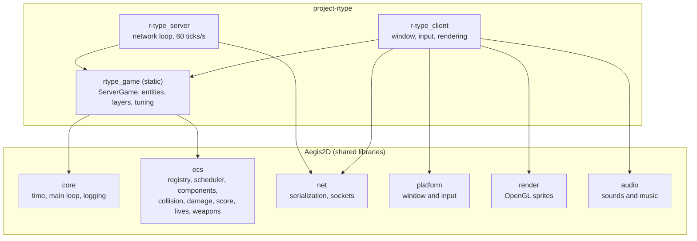
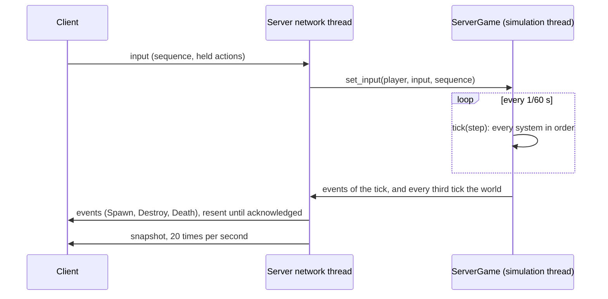

# Architecture

R-Type is a thin game on top of the Aegis2D engine. The engine provides generic
building blocks (an ECS, gameplay systems, networking, rendering, audio); the game
chooses the entities, the values and the order of the systems.

## Layers



| Layer | Where | Server | Client |
|---|---|---|---|
| Game logic | `rtype_game` (`game/`) on the engine's `ecs` | ✓ | to predict and display |
| Networking | engine `net`, wired in `server/` and `client/` | ✓ | ✓ |
| Rendering, input, sound | engine `platform`, `render`, `audio` | | ✓ |

The server never links the client modules: the `server` presets build without SDL3 or
OpenGL.

## Authoritative server

The server owns the only true world. Each client sends the actions its player holds
(one byte per tick: up, down, left, right, fire), each tick's input numbered and sent
again with the next three, so a lost datagram loses no input; the server applies each
once, runs the simulation and sends back what happened, and each snapshot tells every
player the number of its last input applied. A client never decides a hit, a kill or a
score.



The server's network side lives in `server/`, around
[`ServerGame`](gameplay.md#the-server-game), which exposes what it needs: `add_player()`,
`set_input()`, `tick()` and the reports of the last tick. `GameServer`
(`rtype/game_server.hpp`) puts the pieces together, for `r-type_server` and for the tests:
`ServerNetwork` on the network thread, each game in its `Room` (`rtype/room.hpp`), and tasks
posted between them. A room owns its `GameInstance`, the `Simulation` thread that runs it, the
`EventTracker` of what its clients learnt and the names of its players; the rooms of a server
run side by side, each on its own thread. Each session belongs to a room (`Session::room`),
and its player number is its number in that room: a login goes to the first room in use with a
free place, or else to a new room for 4 players (`Room 2`...), and the inputs, snapshots and
events of a room only go between its game and its own players. Over TCP, a logged-in client
may list the rooms in use (`ListRooms`, answered by `RoomList`: number, name, players, size,
waiting or playing) and create one, empty, for the next logins (`CreateRoom`, with a name, 1 to
4 players and the rules of its game: lives, difficulty, waves file and friendly fire, answered
by `RoomCreated` or `RoomRejected` with the first bad value), as section 3.6 of the RFC says;
the waves files a room may name are those next to the server's own (`waves_names()`);
`SessionTable` keeps the rooms in use, from their creation until their last session leaves or
ends. Out of game, a client also moves to another room (`JoinRoom`, answered by `RoomJoined`
or `JoinRejected`) or to the lobby, out of every room (`LeaveRoom`), and says when it is ready
(`SetReady`); the clients of a room that use these messages get its players and their ready
states (`RoomPlayers`) whenever they change, then `GameStart` once every player out of game
is ready, after which they bind and play (RFC section 3.7). A client that never sends them
binds right after its login and plays in the room it was given. `ClientSession` does so
unless `ClientSettings::choose_room` is set: it then stays in the `Lobby` state, with the
rooms refreshed every second, until it joins one, then in the `InRoom` state, with the players
of the room, until `GameStart`; `RoomListForm` is the room list screen of `r-type_client`
apart from its drawing. A room opens when its first player joins, its game on a new thread
with the rules the room was created with (`game_rules()`: the lives of each player, the health
and spawn rate of the enemies for its difficulty, friendly fire, and the waves file it names,
read once at start by `r-type_server` and given with `GameServer::set_waves()`; a room opened
for a login plays the default rules), and closes when its last player leaves: its thread is stopped and joined, and the next player
of that room starts a new game. `r-type_server` plays up to `--max-rooms` rooms at once (4 by
default); once they are all full, a login is refused as `ServerFull`. Players chat over TCP, in the
lobby, in a room and in game (RFC section 3.8): a `ChatSend` whose text passes
`check_chat_text()` (1 to 200 bytes of UTF-8 without control characters) and whose sender is
within its `ChatRate` (5 messages at once, then 1 per second) goes as a `ChatMessage` to every
session of the sender's room, or of the lobby (`player` 255), the sender included; any other
gets `ChatRejected` with its reason, the connection going on. `ClientSession` ignores the chat
until the client shows it. A bound player joins the
game of its room: the others there get its `PlayerJoined` (number and name), and it gets a
`PlayerJoined` of every player already there before the world. A player whose session ends leaves it, whatever ended it (`Logout`, `Disconnect`,
protocol error, its TCP connection closing, as when its process is killed, or no valid
datagram for 5 seconds, as when its UDP is blocked): the others get its `PlayerLeft`, with
the reason `Left`, `TimedOut` or `Kicked`, and its ship is removed at the next tick.

A client can only break its own session. `ServerNetwork` contains the handling of each
datagram and TCP message: an exception is logged, the client that sent the packet is
kicked (`Logout` with `ProtocolError`, `Kicked` for the others), and the sockets go on
serving the rest. The simulation thread does the same for its commands and ticks, and the
loop of `r-type_server` logs anything else that throws and goes on.

After each tick, the simulation thread hands the network thread two things:

- **Events** (`rtype/events.hpp`, RFC section 4.4): `EventTracker` compares the replicated
  entities with those of the previous tick. A new one is a `Spawn` (the shot of a missile
  is its `Spawn`, owned by the shooter's player), a vanished one a `Destroy` at its last
  position, whose reason comes from the tick's reports (killed, missile spent, off screen,
  player left), and each life lost a `Death`. Each player's `ReliableChannel` resends them
  until they are acknowledged. A player who joins first gets a `Spawn` of every entity
  already there.
- **Snapshots** (`rtype/snapshot.hpp`, RFC section 4.3), every third tick: the position,
  velocity and frame of every entity, and each player's lives and score. They are not
  resent: the next one replaces a lost one. Their fields are packed bit by bit with the
  engine's `BitWriter`, by the encoders of `rtype/compact.hpp`: positions to the 1/8 px on
  15 bits (-2048 to 2047.875, off by 1/16 px at most), velocities in whole pixels per second
  on 12 bits (off by 0.5 px/s at most), both clamped to their range, and numbers that grow
  (ids, scores) as varints of 7-bit groups. The entity records go by increasing index (the
  24 low bits of the network id), each giving the gap to the previous index and the 8 bits
  of generation: 77 bits (10 bytes) instead of 22 bytes while the gap is below 128, as it
  stays between live entities.
  Each player's `SnapshotHistory` keeps the last 32 snapshots sent to it with the sequences
  of their datagrams; the `ack` and `ack_bits` of every datagram the player sends mark them
  acknowledged, a snapshot once all its datagrams are. The latest acknowledged one is the
  baseline of the delta snapshots (`rtype/delta_snapshot.hpp`): `write_delta_snapshot()`
  skips the entities whose quantized fields did not change, sends only the changed fields
  of the others (x, y, velocity, frame), every field of the new ones and the id of the
  removed ones, or every entity without a baseline; `apply_delta()` rebuilds the snapshot
  from the baseline and the payloads of its tick. The server encodes each snapshot for each
  player against that player's latest acknowledged one (`ServerNetwork::send_snapshot()`).
  The client's `SnapshotDecoder` (`rtype/snapshot_decoder.hpp`) keeps the last 32 snapshots
  it rebuilt, each from the payloads of its tick received so far, as the baselines of the
  next ones. A payload whose baseline it no longer has is dropped and its datagram not
  acknowledged, so the server never builds on a snapshot the client could not rebuild.

On the client, one thread does everything, once a frame: it reads the keyboard and the
gamepad, runs the network handlers that are ready (`NetworkContext::poll()`), then draws.
`ClientSession` sends the held actions every tick, numbered from 0 (`last_input()`), and
applies what arrives to `ClientWorld`, its copy of the world, where its player's record
gives the last of its inputs the server applied (`acknowledged_input()`); the screen draws
that copy where it was a moment ago, between two snapshots (`interpolate()`), so that 20
snapshots a second move the entities smoothly at any frame rate. The moment follows the
jitter (`interpolation_delay()`): one snapshot interval, 50 ms, plus 1.25 times the latest
snapshot of the last 2 seconds, up to 200 ms, so the tick drawn always has a snapshot after
it; it rises at half real time and goes down by 10 ms a second, so the drawing never jumps
back. The player's own ship is the exception: `ShipPrediction` (`rtype/ship_prediction.hpp`)
moves it at once by each input sent, with the server's own step (`step_ship()`), from the
server's position of the ship in a snapshot, and keeps the inputs the snapshots have not
acknowledged yet; the screen draws the ship there, so it answers the keys within a frame
whatever the round trip time. Each newer snapshot reconciles it
(`ShipPrediction::reconcile()`): the ship goes back to where the server had it once it
applied the acknowledged input, and the inputs after it are replayed; when the server
applied them as predicted, nothing moves (`corrections()` counts the times something did,
for the lagometer). The drawn ship does not jump with a correction: it glides to the
corrected position at 120 pixels per second (`smooth()`, `drawn()`), unless the correction
is 32 pixels or more. The events applied are handed to the screen
(`ClientWorld::take_events()`), which shows them: an explosion and a sound for a kill, a
notice when a player joins or leaves. The client never changes the world itself.

The session also measures its link to the server, for the network statistics shown to the
player: the datagrams and bytes by packet type (`traffic()`), the round trip time and its
jitter (`rtt()`), and, over the last 2 seconds, the datagrams lost (the gaps in the
server's sequences), the mean time between two snapshots and how irregularly they arrive
(`network_stats()`, see `rtype/network_stats.hpp`). The lagometer (`rtype/lagometer.hpp`)
samples them ten times a second and keeps the last 10 seconds, which `lagometer_view`
draws as graphs over the game when the player presses F6.

## The code

```
game/
  include/rtype/
    server_game.hpp   ServerGame: the world, its systems in tick order, the players
    entities.hpp      spawn_player, spawn_player_missile, fire_enemy_missile...
    enemy_scripts.hpp EnemyScripts: the enemy types of assets/enemies and their behaviors
    layers.hpp        collision layers and masks
    tuning.hpp        every gameplay value (speeds, sizes, health, lives, scores)
    waves.hpp         waves files, load_waves
  server_game.cpp
  enemy_scripts.cpp
  entities.cpp
  waves.cpp
assets/waves/         enemy waves (JSON), copied next to r-type_server
assets/enemies/       enemy types (Lua), copied next to r-type_server
server/main.cpp       r-type_server
client/
  network/            rtype_client_net, built and tested by every preset
    client_session    login, UDP binding, inputs, loss of the server
    client_world      the world from snapshots and events, interpolation
    connect_form      the fields of the connect screen, checked
    lagometer         the network statistics of the last 10 seconds, sampled
    network_stats     loss, snapshot interval and jitter of the server's datagrams
    player_notices    "<name> left the game" and the like
    snapshot_decoder  the snapshots rebuilt from their baseline and delta
  ui/                 rtype_client_ui, built and tested with the client
    connect_fields    the connect screen's fields as the engine's text fields
  client_app          r-type_client: window, screens, settings keys, frame metrics (F12)
  game_view           the game screen: entities, explosions, HUD, notices
  lagometer_view      the lagometer overlay, toggled with F6
  menu_screens        connect, joining and connection lost screens
  game_art, game_sounds, preferences   sprites, sounds, player settings
assets/sprites/, assets/sounds/   art and sounds, copied next to r-type_client
tools/bot/            r-type_bot: headless clients holding random or scripted inputs
tools/net_benchmark.py   the server and bots under each netem profile, into a CSV
tests/                Catch2 tests of rtype_game
```

- **The engine does the generic work.** Movement, collisions, damage, score, lives and
  weapons are engine functions (`aegis2d::ecs`, see the
  [engine API](https://aegis2d-docs.pages.dev/api/)). The game only composes them; a
  feature any shoot'em up would need goes to the engine first, then is wired here.
- **Data lives in components, values in `tuning.hpp`.** Entities are plain handles; what
  they are comes from their components, and every number comes from `rtype::tuning`.
- **`rtype_game` is a static library.** The engine's registry finds component pools by
  `typeid`. With libc++ (macOS), a type's `typeid` differs between shared libraries, so
  code that reads components must be compiled into the binaries, never behind another
  shared library.
- **Systems are functions.** Each step of the tick is a function registered in the
  engine's `Scheduler` under a name, so the order is written in one place
  (`ServerGame::register_systems()`) and can be listed, disabled or tested on its own.

## Delivery

Development happens in two repositories, the engine and the game. For the Epitech
delivery, a push to `master` here asks the engine repository to assemble both into the
Epitech repository (the engine's `master` and this `master`), build it and publish it.
See the engine's
[Epitech delivery mirror](https://aegis2d-docs.pages.dev/epitech-mirror/) page.
