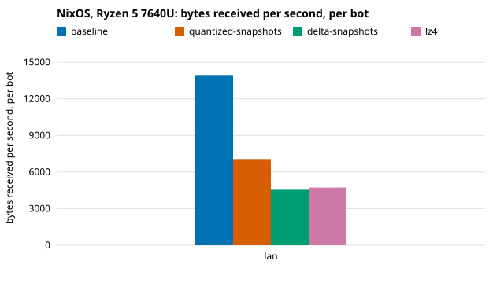
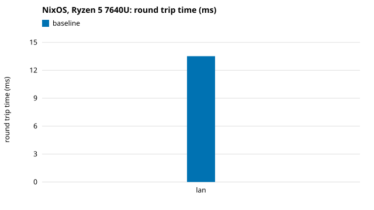

# Network benchmark

The game must stay playable with 150 ms of latency and a few datagrams lost, and the
network epics reduce the bandwidth and hide the lag: delta snapshots, quantized records,
client-side prediction. This page holds their numbers: the same game is measured under the
same degraded networks before and after each optimization, on the team's machines.

## Method

`tools/net_benchmark.py run` starts `r-type_server` and, for each profile, degrades its two
ports on the loopback with the engine's `tools/netem.sh`, then plays four bots
(`r-type_bot --count 4 --seconds 30 --seed 1 --stats`) holding random inputs, the same at
every run. Each bot measures its own link when it leaves; a line of results is the mean of
the four:

| Profile | netem on each packet | Loss on each packet |
|---|---|---|
| `lan` | nothing | 0 % |
| `50ms` | 50 ms | 0 % |
| `150ms-2%` | 150 ms | 2 % |
| `300ms-5%` | 300 ms | 5 % |

On the loopback each packet is delayed and may be lost on its way there and on its way
back: the round trip grows by twice the delay.

- **In / Out**: bytes received and sent per second by one bot, the protocol's 18-byte
  header included, the IP and UDP headers not: the bandwidth a player needs.
- **RTT**: the smoothed round trip time at the end of the game, and its jitter.
- **Loss** and **snapshot jitter**: over the last 2 seconds, the server's datagrams lost and
  how irregularly the snapshots arrive.
- **Corrections**: the corrections of the predicted ship, once the client predicts it.

Each run carries a label: `baseline` for the code before the optimizations, then the name
of each one (`delta-snapshots`, `prediction`...). In the tables, the numbers of a label are
followed by their change from the first label of the machine.

## Measure a machine

```bash
cmake --preset linux-release && cmake --build build/linux-release
python3 tools/net_benchmark.py run --build build/linux-release --name "Arch, Ryzen 7" \
    --label baseline
python3 tools/net_benchmark.py report
```

`run` writes `docs/network-benchmark/<machine>.csv`, replacing the lines of its label and
keeping the others; `report` rewrites the results below and their charts from every CSV of
that folder. netem needs root: the script runs `netem.sh` with `sudo`, and `--profiles lan`
measures without it. [Getting started](getting-started.md#network-benchmark) lists the
options and the columns of the CSV.

## Results

<!-- results:begin -->

### NixOS, Ryzen 5 7640U

Linux 6.18.55; 4 bots for 30.0 s per profile; in parentheses, the change from baseline.

| Profile | Run | In (B/s) | Out (B/s) | RTT (ms) | RTT jitter (ms) | Loss (%) | Snapshot jitter (ms) | Corrections |
|---|---|---:|---:|---:|---:|---:|---:|---:|
| lan | baseline | 13889.15 | 1141.20 | 13.51 | 2.04 | 0.00 | 0.25 | - |
| lan | quantized-snapshots | 7067.90 (-49 %) | 1141.00 (-0 %) | 12.98 (-4 %) | 0.68 (-67 %) | 0.00 | 0.41 (+64 %) | - |
| lan | delta-snapshots | 4544.42 (-67 %) | 1141.20 | 15.18 (+12 %) | 1.88 (-8 %) | 0.00 | 0.40 (+60 %) | - |
| lan | lz4 | 4725.97 (-66 %) | 1141.10 (-0 %) | 14.75 (+9 %) | 1.80 (-12 %) | 0.00 | 0.37 (+48 %) | - |





<!-- results:end -->
